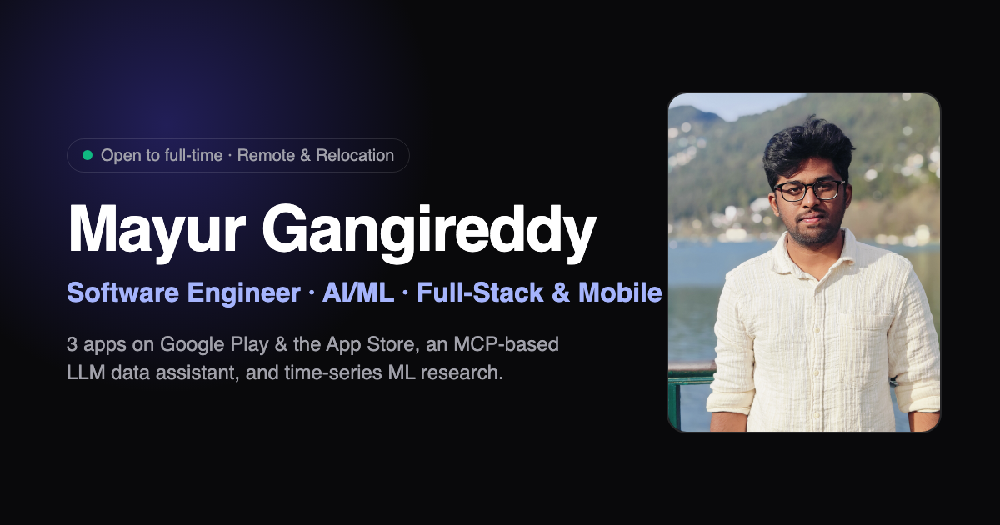

# Mayur Gangireddy — Portfolio

Personal portfolio of Mayur Gangireddy, a software engineer working across mobile, full-stack and applied AI.

**Live site:** https://portfolio-steel-six-n4cc8s07o5.vercel.app



## What's inside

- **Projects** with case studies and real (redacted) app screenshots: a 500K+ download utility app, an IoT smart-home app, a police academy app, and client systems for temple donations, hostel management and digital signage
- **Architecture** diagrams for the main systems
- **Experience** timeline, skills, and short technical articles
- **Resume** as a one-page PDF, generated from HTML

## Tech stack

React 18 · TypeScript · Vite · Tailwind CSS · Framer Motion · lucide-react, deployed on Vercel.

## Run locally

```bash
npm install
npm run dev        # start the dev server
npm run build      # production build into dist/
npm run typecheck  # TypeScript checks
```

## Resume

The resume lives in `generate_resume.py` as HTML. Running it prints the HTML to PDF with headless Chrome and writes both `public/Mayur_Gangireddy_Resume.pdf` (served by the site) and a copy at the repo root.

```bash
pip install pypdf
python3 generate_resume.py
```

It expects Google Chrome at `/Applications/Google Chrome.app` (macOS).

## Project structure

```
src/components/      page sections (Hero, Projects, Experience, ...)
  ProjectCover.tsx   project card media: screenshots, image or generated cover
public/projects/     app screenshots and illustrated SVG covers
generate_resume.py   resume source and PDF build script
```
